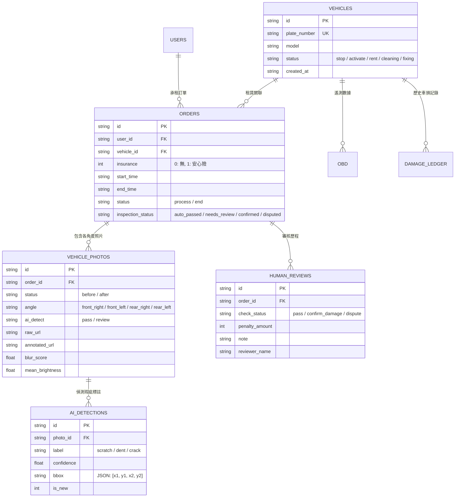

# 🛡️ Car_Dectec 智能租賃車輛車況檢驗與客服審核管理系統

## 📑 目錄

- [核心功能亮點](#-核心功能亮點)
  - [1. Android 客戶端 (取車與還車拍照導引)](#1-android-客戶端-取車與還車拍照導引)
  - [2. 雙階段 AI 車損辨識引擎](#2-雙階段-ai-車損辨識引擎)
  - [3. 客服審核與車隊管理後台](#3-客服審核與車隊管理後台)
  - [4. 完整業務關聯式資料庫](#4-完整業務關聯式資料庫)
- [目錄架構](#-目錄架構)
- [環境需求與準備](#-環境需求與準備)
- [快速啟動指南](#-快速啟動指南)
  - [一鍵啟動後端與管理後台](#一鍵啟動後端與管理後台)
  - [啟動 Android APP](#啟動-android-app)
- [API 介面規格說明](#-api-介面規格說明)
- [資料庫架構設計 (Database Schema)](#-資料庫架構設計-database-schema)

## 🌟 核心功能亮點

### 1. Android 客戶端 (取車與還車拍照導引)

- **4 角度智慧環車導引**：右前方、左前方、右後方、左後方預設輪廓透視指引。
- **Google ML Kit 即時車體對齊檢測**：相機畫面即時識別車輛邊界，未對齊時提示調整距離與角度，對齊後觸發高亮提示。
- **照片旋轉與 EXIF 自動校正**：解決特定手機拍攝與相簿上傳時圖片順時針旋轉 90 度問題，無論直拍、橫拍或相簿選取均完美維持正向。
- **內建連線設定視窗**：支援一鍵切換 `127.0.0.1:8000`（USB 端口轉發）、`10.0.2.2:8000`（Android 模擬器專用）或自訂區域網路實體 IP（如 `192.168.x.x`）。
- **細節刮痕特寫模式**：使用者可針對特定刮痕處拍攝特寫，支援多張上傳並標註受損位置。

### 2. 雙階段 AI 車損辨識引擎

- **Stage 1 (車體語意分割)**：採用 `yolov8n-seg.pt` 生成車輛主體二值遮罩（Mask），過濾背景中的地面碎石、牆面刮痕或鄰車雜訊。
- **Stage 2 (車損精準偵測)**：採用專屬訓練之 `best.pt` 模型，精準辨識刮痕（Scratch）、凹痕（Dent）、破裂與剝落。
- **Canny 邊緣密度過濾器**：針對高反光、陽光折射等高頻誤判場景，藉由邊緣梯度密度分析排除平滑反光面誤判。
- **影像品質評估演算法**：自動計算拉普拉斯算子方差（Laplacian Variance）評估模糊度，並計算平均亮度檢測過曝或夜間暗光。
- **智慧時間窗批次聚合**：10 分鐘內同車輛拍攝的多角度照片自動歸併入同一張檢驗訂單，避免訂單碎片化。

### 3. 客服審核與車隊管理後台

- **📊 數據看板 (POC Dashboard)**：
  - 即時呈現 AI 自動通過率 (Auto-Pass Rate)、人工複審比例、平均處理耗時與誤判率。
  - 24 小時直通 vs 複審趨勢圖、瑕疵類型分佈統計（刮痕、凹痕、擦傷等）。
- **📋 訂單與審核工作台 (Review Workbench)**：
  - **同批照片集中摺頁**：同一租借批次的照片集中於單一摺頁，以 Tab 分頁一鍵切換視角。
  - **Before vs. After 雙視窗對照**：取車前原貌與還車後影像對齊比對，支援「顯示 AI 標註框與熱區遮罩」開關切換。
  - **一站式審核面板**：快速填寫求償金額、責任歸屬判定（租借人過失 / 既有舊傷誤判 / 第三方不明）與審核備註，一鍵完成「確認車損扣款」、「標記誤判/免賠」或「待申訴/補件」。
  - **高對比 UI 設計**：針對深色與淺色瀏覽器環境專門適配，徹底杜絕白底白字問題。
- **🚗 車輛追蹤與履歷 (Damage Ledger)**：
  - 整合車隊營運狀態（可租借、租借中、清潔中、維修中）。
  - **既有車損歷史帳本**：記錄歷次已結案舊傷，避免對新承租人重複求償。
  - 維修與檢驗歷史時間軸（Timeline）完整記錄。

### 4. 完整業務關聯式資料庫

- 基於 SQLite 建立 8 大核心實體表：
  `vehicles`（車輛）、`obd`（車載遙測）、`users`（會員）、`orders`（租賃訂單）、`vehicle_photos`（檢驗相片）、`ai_detections`（AI 標註紀錄）、`human_reviews`（人工複審歷程）、`damage_ledger`（舊傷帳本）。

---

## 📁 目錄架構

```
Car_Detect/
├── app/                                    # Android 客戶端原始碼 (Kotlin + Jetpack Compose)
│   ├── build.gradle.kts                   # 模組級 Gradle 設定 (CameraX, ML Kit, Compose)
│   └── src/main/
│       ├── AndroidManifest.xml            # 相機與網路權限聲明
│       ├── java/com/example/car_detect/
│       │   ├── MainActivity.kt            # APP 入口與取車導引首頁 (PickupHomeScreen)
│       │   ├── CameraScreen.kt            # 4 角度相機拍照、ML Kit 車體對齊、伺服器 IP 設定
│       │   ├── ScratchInspectionScreen.kt # 細部刮痕特寫拍照畫面
│       │   └── CarDamageApiService.kt     # Retrofit / OkHttp 網路傳輸層
│       └── res/                           # 圖片資源、車輛透視導引圖示與向量資源
│
├── server/                                 # 後端 API 與 AI 推論服務
│   ├── main.py                            # FastAPI 應用、雙階段 YOLO 車損辨識管線、REST API
│   ├── database.py                        # SQLite 資料庫連線、ORM 操作與歷史資料聚合
│   ├── admin_app.py                       # Streamlit 客服審核工作台與戰情看板
│   ├── pyproject.toml                     # Python 專案相依性定義 (uv / pip)
│   ├── requirements.txt                   # 傳統 pip 相依性清單
│   ├── yolov8n-seg.pt                     # Stage 1 車體語意分割權重檔
│   ├── .streamlit/
│   │   └── config.toml                    # Streamlit 全域主題設定 (強制淺色模式高對比)
│   ├── NewYoloModel/
│   │   ├── best.pt                        # Stage 2 車損分類與定位優化權重
│   │   ├── example.py                     # 演算法單機離線推論與測試腳本
│   │   └── README.md                      # 模型說明
│   ├── static/uploads/                    # 上傳照片與 AI 標註圖存檔目錄
│   └── data/
│       └── carguard.db                    # 核心 SQLite 資料庫檔案
│
├── start_all.bat                           # 🚀 Windows 一鍵啟動所有服務 (ADB 轉發 + FastAPI + Streamlit)
├── start_admin.bat                         # 僅啟動 Streamlit 管理後台
├── stop_all.bat                            # 停止所有運行中服務
├── push_test_images_to_emulator.bat        # 推送測試車損圖片至 Android 模擬器相簿
└── README.md                              # 專案說明文件
```

---

## 🔧 環境需求與準備

### 1. 後端與 AI 服務環境

- **作業系統**：Windows 10/11、macOS 或 Linux
- **Python 版本**：Python 3.10 以上 (建議使用 [uv](https://github.com/astral-sh/uv) 進行極速套件管理)
- **硬體建議**：支援 CUDA 之 NVIDIA 顯示卡（選配，CPU 亦可順暢推論）

### 2. Android 客戶端環境

- **Android Studio**：Ladybug (2024.2.1) 或更高版本
- **Android SDK**：Min SDK 31 (Android 12)，Target SDK 35
- **設備需求**：配備相機鏡頭之 Android 實體手機，或支援相機模擬之 Android 模擬器

---

## 🚀 快速啟動指南

### 一鍵啟動後端與管理後台

專案根目錄提供批次腳本，會自動設定 ADB 端口轉發並同時拉起 FastAPI 與 Streamlit：

```bash
# 點擊或在終端機執行：
.\start_all.bat
```

腳本將會自動執行以下流程：

1. 檢測 Android SDK `platform-tools`，自動執行 `adb reverse tcp:8000 tcp:8000`（讓手機可直接使用 `localhost:8000` 存取後端）。
2. 在 Port `8000` 啟動 **FastAPI** 後端。
3. 在 Port `8501` 啟動 **Streamlit** 管理後台。

啟動完成後即可開啟瀏覽器造訪：

- **客服審核工作台**：[http://localhost:8501](http://localhost:8501)
- **FastAPI 互動式 Swagger 文檔**：[http://localhost:8000/docs](http://localhost:8000/docs)

> 💡 若習慣手動啟動：
>
> ```bash
> cd server
> # 使用 uv (推薦):
> uv run uvicorn main:app --host 0.0.0.0 --port 8000 --reload
> uv run streamlit run admin_app.py --server.port 8501
>
> # 或使用傳統 pip:
> pip install -r requirements.txt
> uvicorn main:app --host 0.0.0.0 --port 8000 --reload
> streamlit run admin_app.py --server.port 8501
> ```

---

### 啟動 Android APP

1. 使用 **Android Studio** 開啟專案根目錄 `Car_Detect`。
2. 等待 Gradle Sync 完成。
3. 選擇實體手機或 Android 模擬器，點擊 **Run 'app' (Shift + F10)**。
4. **手機連線伺服器設定說明**：
   - **實體手機透過 USB 連線**：直接使用預設之 `http://127.0.0.1:8000`（`start_all.bat` 已自動建立 reverse tunnel）。
   - **Android 官方模擬器**：點擊相機畫面左上方 **「⚙️ 設定 IP」**，切換為 `http://10.0.2.2:8000`。
   - **實體手機透過 Wi-Fi 連線**：確保手機與電腦處於同一 Wi-Fi，點擊「⚙️ 設定 IP」填入電腦區域網路 IP（例如：`http://192.168.1.100:8000`）。

> 💡 **測試小工具**：
> 專案包含 `push_test_images_to_emulator.bat`，可一鍵將測試車損圖片推送至 Android 模擬器之相簿目錄，方便透過「相簿選取」進行快速驗證。

---

## 📡 API 介面規格說明

FastAPI 後端提供標準 RESTful 介面：

| 方法    | 端點路徑                       | 說明                               | 主要參數                                                                           |
| ------- | ------------------------------ | ---------------------------------- | ---------------------------------------------------------------------------------- |
| `POST`  | `/predict`                     | 上傳檢驗照片並執行雙階段車損辨識   | `file` (Multipart 圖片), `plate_number`, `angle`, `order_id` (選填)                |
| `GET`   | `/api/cases`                   | 獲取管理後台之訂單檢驗與審核列表   | `status` (篩選條件: `all`, `needs_review`, `auto_passed`, `confirmed`, `disputed`) |
| `PATCH` | `/api/cases/{order_id}/review` | 客服人員提交人工審核判定與扣款結果 | `status`, `note`, `reviewer`, `penalty_amount`                                     |
| `GET`   | `/api/vehicles`                | 查詢車隊所有車輛狀態與舊傷帳本清單 | 無                                                                                 |
| `GET`   | `/static/uploads/{filename}`   | 靜態資源路由，存取原圖與 AI 標註圖 | 圖片檔案名稱                                                                       |

### `/predict` 返回範例

```json
{
  "status": "success",
  "message": "辨識完成，偵測到 1 處疑似車損",
  "order_id": "ORD-20260921-A1B2",
  "damage_count": 1,
  "quality_metrics": {
    "blur_score": 386.4,
    "is_blurry": false,
    "mean_brightness": 128.5,
    "is_dark": false,
    "is_overexposed": false
  },
  "predictions": [
    {
      "label": "scratch",
      "confidence": 0.88,
      "bbox": [210, 340, 480, 520],
      "pos": "(210, 340)"
    }
  ],
  "annotated_image_base64": "data:image/jpeg;base64,..."
}
```

---

## 🗄️ 資料庫架構設計 (Database Schema)

系統採用 SQLite 作為本機/邊緣資料存儲，嚴格依照業務流程建立關係模型：


